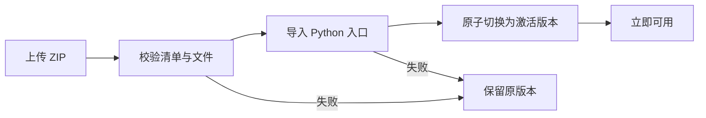

# 源码插件

管理员打开“插件”，上传 ZIP，安装成功即激活；可即时停用、重新激活或上传同名包升级，无需重启。插件与激活配置仅保存于 `plugins/.installed/`；业务数据不随停用删除。不要手工修改 `.installed`。源码部署保留此目录。



## 包格式

ZIP 根目录必须有 `plugin.json`，不要额外套一层文件夹。

```json
{
  "name": "hello-plugin",
  "displayName": "示例插件",
  "version": "1.0.0",
  "providerEntry": "backend.py:router",
  "frontendEntry": "index.html"
}
```

`providerEntry` 和 `frontendEntry` 至少填写一个。前端为 HTML/JS/CSS，使用相对资源路径。Python 文件导出 FastAPI `APIRouter`；可使用包内相对导入。参考 `examples/hello/`，将该目录下的文件压成 ZIP 后上传。

- 页面：`/extensions/hello-plugin/assets/index.html`
- API：`/extensions/hello-plugin/api/hello`，请求携带 `Authorization: Bearer <登录令牌>`。
- 已认证用户信息：`request.state.user`。所有 API 默认需要本站有效账号；插件必须自行检查管理员角色和业务数据权限。
- 已激活列表：`GET /api/plugins`；安装列表：`GET /admin/plugins`；上传：`POST /admin/plugins/upload`，multipart 字段 `file`；启停：`PATCH /admin/plugins/{name}`，正文 `{"active":false}`。

Python 插件是可信管理员代码，拥有服务账号权限；上传不会自动安装 pip 依赖。使用服务器已有依赖和请求级初始化；不支持 lifespan/startup/shutdown、后台常驻循环或修改宿主全局路由。停用阻止后续请求，已开始的请求可自然结束。模块顶层保持无外部副作用；导入失败只能回滚插件版本，无法撤销插件自己执行的外部写入。

ZIP 最大 20MB、最多 500 个条目、解压最大 60MB；禁止越界路径、符号链接、加密包和重复路径。静态资源不需要登录，不得放置密钥、用户数据或服务配置。Python 源码不通过静态入口下载。旧版本目录保留供排障，不自动清除。

## 需求中心

管理员点击“下载需求中心插件 ZIP”获得可再次上传的需求中心插件，支持默认激活、即时启停和升级。插件包括 Python 适配器与完整页面/JS/主题/指南，复用兼容宿主已有的需求、账号、附件及 API；主站原 API 保留兼容。它是面向 SWTool 宿主的插件协议，并非原生 WordPress/PHP 插件；若需单独运行，使用“下载需求中心源码”的完整独立安装包。
