# SWTool需求中心 · 用户与部署指南

## 1 · 从注册开始

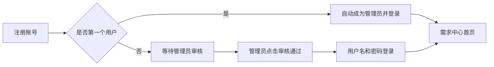

忘记密码：联系管理员 → 账号管理 → 重置密码 → 用新密码登录。无需邮箱验证。

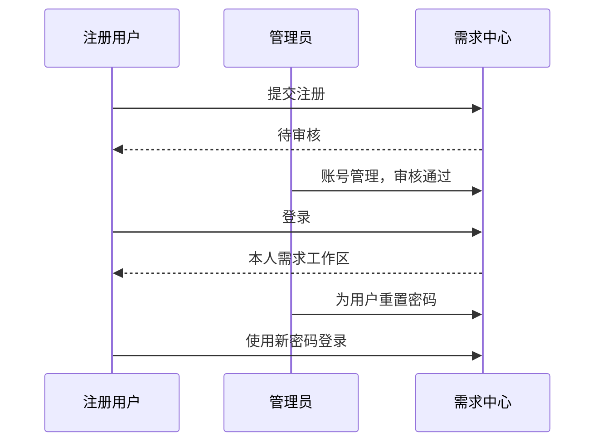

## 2 · 首页入口

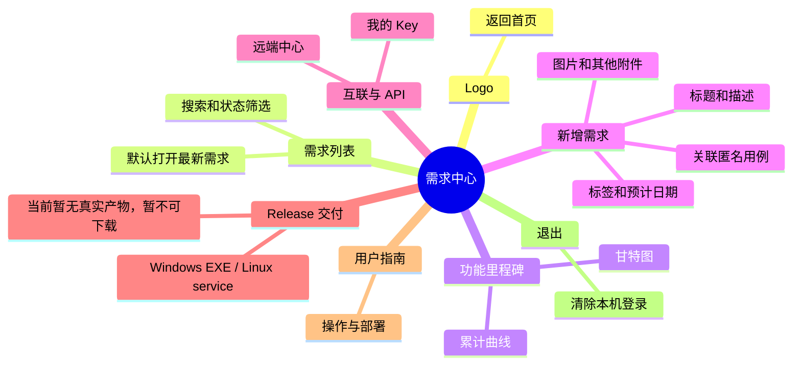

普通用户查看、编辑本人需求；管理员管理全部需求。远端权限由目标账号决定。

### 三种外观

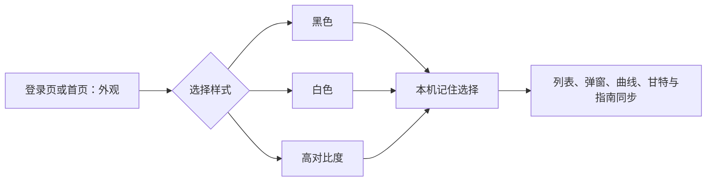

无需登录即可选择；首次按系统深浅偏好显示。用户手动选择后，刷新、退出再登录及打开指南都保留设置，同源标签页同步；高对比度使用黑底、白字、黄色焦点与清晰边框。设置只保存在当前浏览器，不会改变其他用户外观。

## 3 · 提交与解决

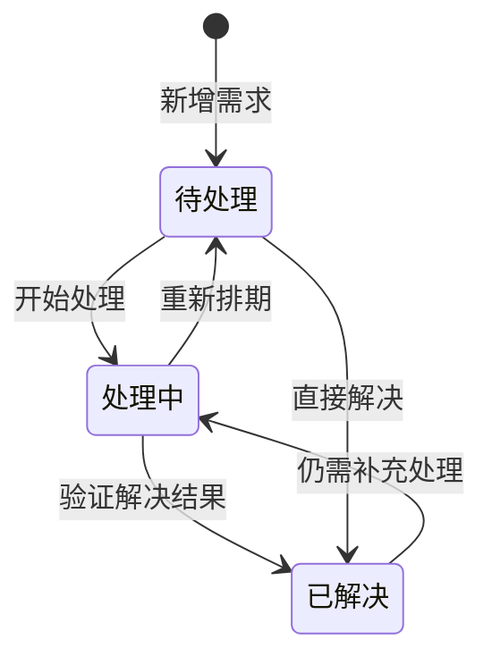

“编辑需求”可修改标题、描述、标签、匿名用例关联、预计日期和状态。预计日期默认未来 7 天。

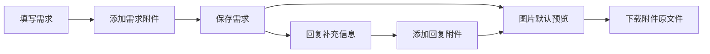

单附件最大 10 MiB；支持图片、PDF、TXT、CSV、JSON、ZIP。上传失败时保留需求，检查提示并重试附件。独立站没有用例影像，已有用例引用随归档保留，不暴露用例原名。

## 4 · 看进度

曲线：X 轴是日期，Y 轴是累计需求数；甘特图显示每项需求的起止与预计日期。点击图上条目打开详情。

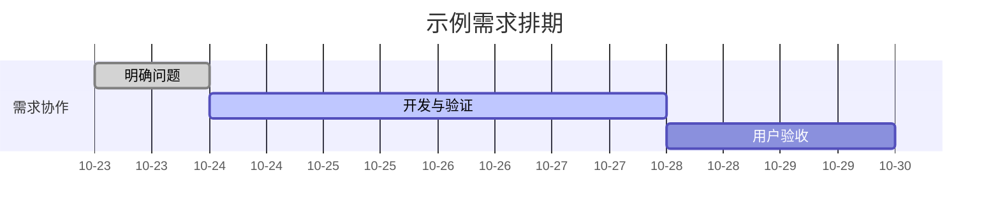

下面是统计口径示例，不代表系统已增加评分算法：

$$
N(t)=\sum_{i=1}^{n}\mathbf{1}(t_i\leq t)
$$

$$
\text{解决率}=\frac{\text{已解决需求数}}{\text{总需求数}}\times100\%
$$

## 5 · 两个中心互联

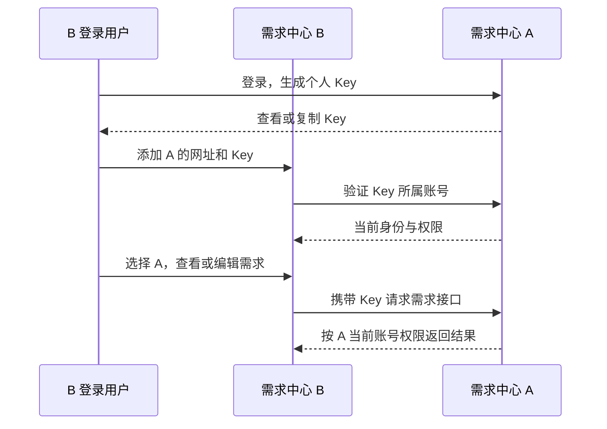

只复制 Key 到可信中心。A 也可添加 B，步骤相同；无需同步数据库。

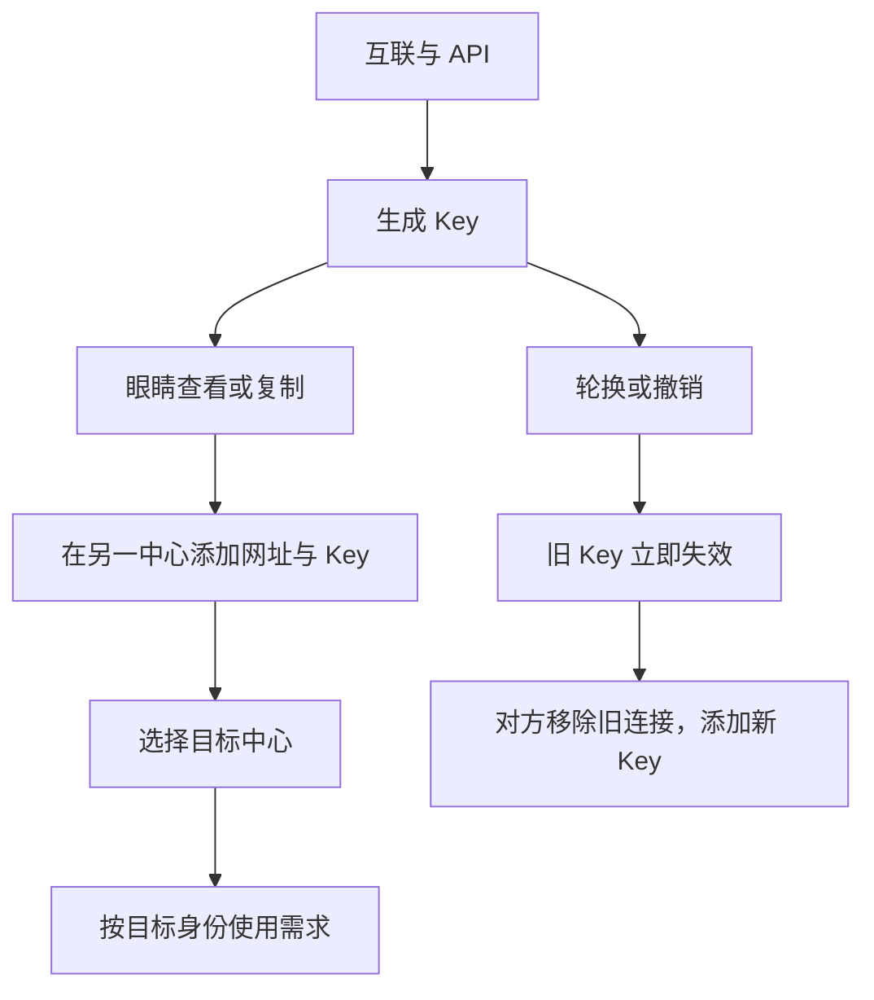

Key 只授权需求功能，不能管理用户、影像或训练。连接 Key 由服务器加密保存。Key 失效时本机仍保持登录。

## 6 · 全站归档

管理员的 ZIP 导出不受当前搜索、分页或选中需求影响。

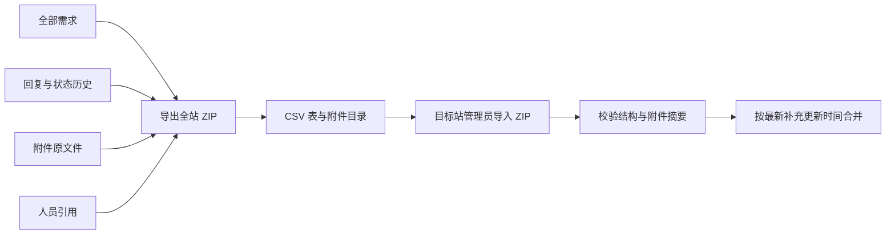

相同 ID 优先去重；仅标题前半段相同不合并。再次导入不重复追加。缺失附件或校验失败会拒绝导入。归档不包含密码和影像。

## 7 · Release 交付与部署

页面可下载需求中心独立源码 ZIP；Windows EXE 与 Linux service Release 由对应平台另行构建，本指南说明正式交付与运行方式。

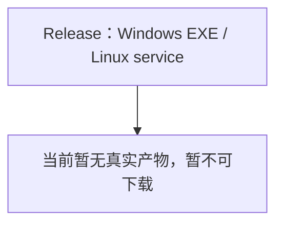

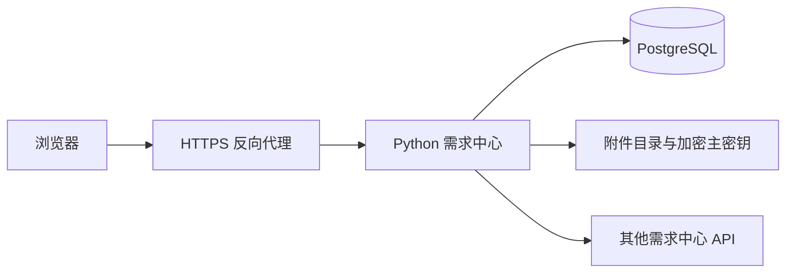

## 8 · 备份与升级

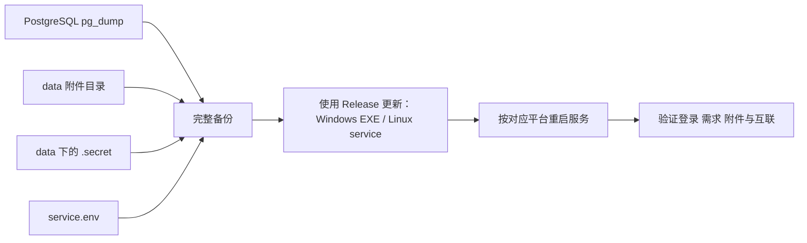

不要丢失或随意更换 `.secret`，否则需重新配置连接 Key。Release 安装包与用户数据归档 ZIP 用途不同。

## 9 · 接口速查

### 使用 API + Key 操作需求

在“互联与 API”中生成个人 Key，选择 `tickets:read` 或 `tickets:write` 作用域，并在请求头中携带：

```http
Authorization: Bearer <Key>
```

接口基址为 `/api/v1/api`，常用操作如下：

- 读取需求：`GET /tickets` 分页读取需求列表，`GET /tickets/{id}` 读取需求详情；`GET /tickets/{id}/attachments` 列出附件，`GET /tickets/{id}/attachments/{attachment_id}` 下载附件；也可先调用 `GET /requirements/identity` 验证 Key、账号和作用域。
- 编辑需求：使用 `tickets:write` Key 调用 `PATCH /tickets/{id}`，提交需要修改的标题、正文、标签、关联用例或预计日期字段。
- 回复需求：使用 `tickets:write` Key 调用 `POST /tickets/{id}/comments`，JSON 请求体传入 `body`；附件接口仍使用 `POST /tickets/{id}/attachments` 的 multipart 字段 `file`，回复附件额外传 `comment_id`。
- 更新状态：使用 `tickets:write` Key 调用 `PATCH /tickets/{id}`，在 JSON 请求体中提交 `status`（如 `open`、`in_progress`、`resolved`、`withdrawn`）；服务端按 Key 所属账号权限限制本人或全部需求的操作范围。

只读 Key 只能读取需求；读写 Key 才能编辑、回复和更新状态。Key 被撤销或所属账号权限变化后，后续请求立即失效。

#### 个人近端中心的 Key 接口

以下路径相对 `/api/v1/api`，也支持 `/plugins/requirements-center/api` 原生插件基址：

- `GET /local-centers`：列出 Key 所属账号自己的近端中心。
- `GET /local-centers/{CENTER_ID}`：读取本人近端中心详情。
- `GET /local-centers/{CENTER_ID}/tickets`：分页读取该中心工单，支持 `page`、`page_size` 和标题/正文搜索参数 `q`。
- `GET /local-centers/{CENTER_ID}/tickets/{TICKET_ID}`：读取该中心内的工单详情。
- `POST /local-centers/{CENTER_ID}/tickets`：仅 `tickets:write` 可新建工单，仍须满足标题、描述等业务校验；平台缺省为 `pc_browser`，合法显式 `platform` 或 `platforms` 按既有规则校验，不被默认值覆盖。

中心和工单标识符仅允许 ASCII 字母、数字、下划线和连字符。`tickets:read` 仅可调用上述 GET；近端中心 Key 接口不支持创建中心/数据库、删除、PATCH、回复或附件子路由，也不授权工具或 Key 管理。管理员 Key 同样只能访问自己的近端中心，跨 owner 或跨中心工单返回 404。此范围与默认 `/tickets` 接口不同：默认工单的管理员 `tickets:write` 仍按既有管理员权限处理，管理员 `tickets:read` 仍限本人默认工单。

以下均为占位示例，替换域名、Key 和标识符后使用：

```bash
curl 'https://example.invalid/<API_BASE>/local-centers' \
  -H 'Authorization: Bearer <PERSONAL_KEY>'
curl 'https://example.invalid/<API_BASE>/local-centers/<CENTER_ID>' \
  -H 'Authorization: Bearer <PERSONAL_KEY>'
curl --get 'https://example.invalid/<API_BASE>/local-centers/<CENTER_ID>/tickets' \
  -H 'Authorization: Bearer <PERSONAL_KEY>' \
  --data-urlencode 'page=1' --data-urlencode 'page_size=10' --data-urlencode 'q=<SEARCH_TEXT>'
curl 'https://example.invalid/<API_BASE>/local-centers/<CENTER_ID>/tickets/<TICKET_ID>' \
  -H 'Authorization: Bearer <PERSONAL_KEY>'
curl -X POST 'https://example.invalid/<API_BASE>/local-centers/<CENTER_ID>/tickets' \
  -H 'Authorization: Bearer <PERSONAL_KEY>' -H 'Content-Type: application/json' \
  -d '{"title":"<TITLE>","description":"<DESCRIPTION>","platform":"pc_browser"}'
```

`<API_BASE>` 可替换为 `api/v1/api` 或 `plugins/requirements-center/api`；最后一个示例需要读写 Key，省略 `platform` 时也使用 `pc_browser`。撤销 Key 或禁用账号后，后续请求仍会实时拒绝。

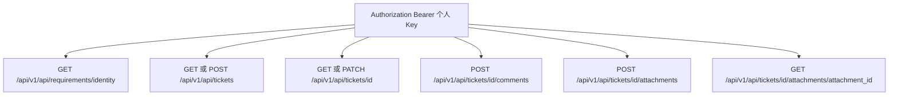

JSON 请求使用 `Content-Type: application/json`，附件用 multipart 字段 `file`；回复附件额外传查询参数 `comment_id`。管理员 Key 支持 `/api/v1/issues/export/zip` 和 `/api/v1/issues/import/zip`。全站 ZIP 已合并到页面“导入，导出”入口，用于用户数据归档的导入与导出。

## 撤回需求


作者和管理员可操作；远端连接按目标账号权限执行。撤回保留所有数据，全站 ZIP 导入导出也保留撤回状态。

### 用令牌管理工单

个人 Key 和运维令牌在工单中具有所属账号的操作权限，可新建、编辑标题/正文/标签/关联用例/预计日期、修改状态、撤回或恢复、回复及上传附件。普通用户令牌只操作本人需求，管理员令牌可管理全部需求并导入导出全站 ZIP。请求使用 `Authorization: Bearer <令牌>`。

权限随账号实时变化；停用账号或撤销令牌后不可使用。令牌只授权工单业务，账号管理、训练等仍须正常登录。互联时使用目标中心的个人 Key，按目标账号权限操作。

## 插件上传与激活

打开顶部“插件”。管理员选择插件 ZIP → 点击“上传并激活”，成功后即可“打开插件”，无需重启。上传同名插件即升级；失败保留旧版。可随时停用或激活，停用不删除需求数据。普通用户可查看和打开已激活插件。

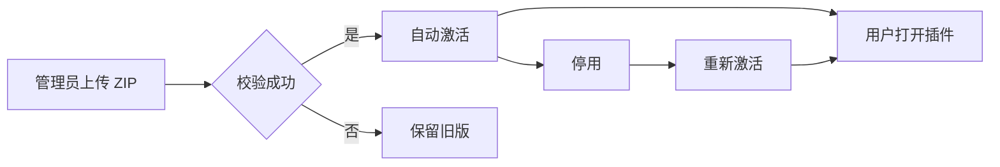

需求中心插件 ZIP 是供兼容宿主安装的适配包，不是独立网站安装包；页面可下载需求中心独立源码 ZIP，Windows EXE 与 Linux service Release 由对应平台另行构建。用户数据归档 ZIP 用于全站需求数据导入与导出。安装文件保存在服务器 `plugins/` 下。Python 插件只上传可信代码。

## 10 · 检查版本与手动升级

工作区的“源码包更新”区域可在线检查独立需求中心版本。发现新版本后，页面会显示版本号、功能说明和下载链接；点击“下载最新源码包”手动保存 ZIP，再按新的目录部署。此入口只下载源码包，不会自动替换当前运行目录。

版本接口为登录后只读的 `GET /api/v1/api/requirements/releases`，返回 `current_version` 和非空 `releases` 列表。下载链接必须使用同源 HTTPS 或相对 URL；若清单不可用、没有可用版本或网络请求失败，页面会显示明确错误，可稍后重试。
